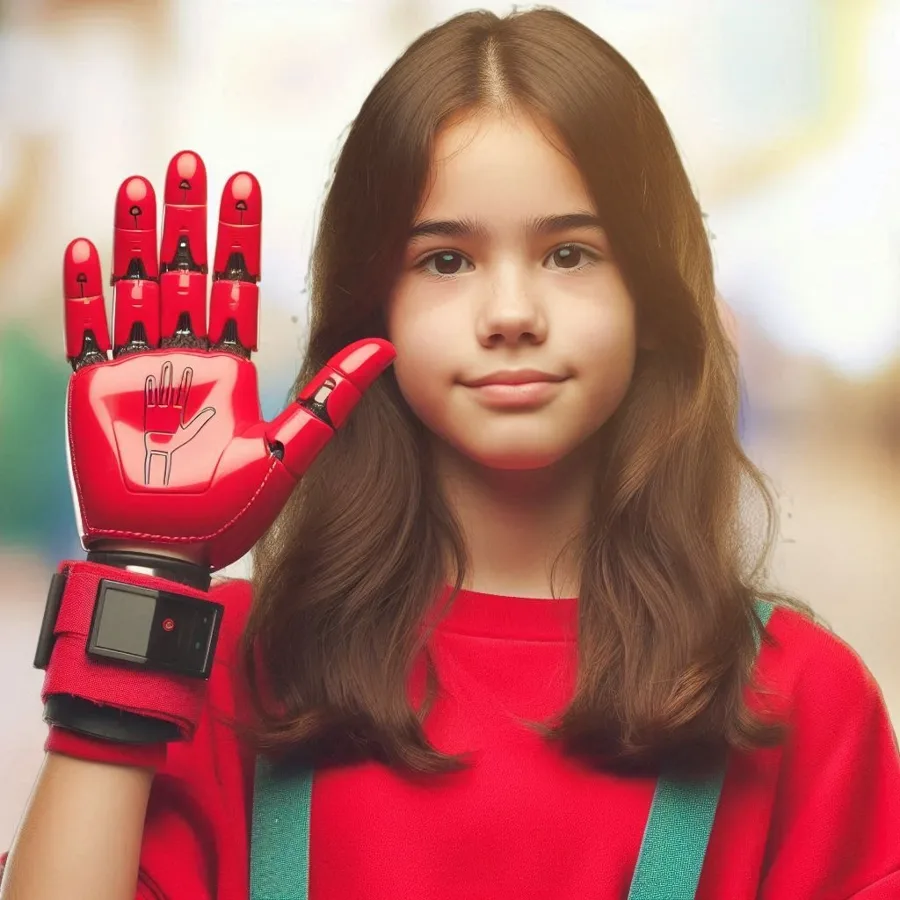

# SignoGlove

Página web que usa el **sensor de movimiento del celular** (giroscopio y acelerómetro) para convertir la posición de la mano en frases habladas, pensada para facilitar la comunicación de personas sordas. El celular va sobre el dorso de la mano o en el guante; la página mide su inclinación, muestra la frase en pantalla y la reproduce en voz alta, en español o en inglés. No necesita placas, cables ni Bluetooth.

*A web page that uses the phone's motion sensor to turn hand positions into spoken phrases, in Spanish or English, to help Deaf people communicate. [English version of the site](en/index.html).*

> La primera versión usaba una placa micro:bit conectada por Web Bluetooth. Ahora el celular hace las dos cosas: mide la inclinación y habla.



## Cómo funciona

1. Abres la página en el celular y tocas **Activar sensor** (en iPhone hay que tocar **Permitir**).
2. La página lee la orientación del celular (`DeviceOrientationEvent`) y usa solo el giro sobre el **eje X** (inclinar hacia adelante o hacia atrás), igual que la micro:bit: **0°** con la pantalla hacia arriba, valores **positivos** cuando sube la parte de arriba del celular y **±180°** boca abajo. Inclinar hacia los lados no cambia nada. El ángulo se ve en vivo debajo del botón.
3. Si la mano se queda unos 0,4 s dentro de un rango, la frase aparece en pantalla y se reproduce su audio.

Valores por defecto (los mismos de la micro:bit):

| Inclinación recibida | Frase del tema |
| -------------------- | -------------- |
| −25 a 35             | 1              |
| 35 a 75              | 2              |
| −75 a −25            | 3              |
| 115 a 140            | 4              |
| 150 a 180            | 5              |

Entre rangos (por ejemplo, de 75° a 115°) no cambia nada: se queda la última frase.

## Calibrar el sensor

La página **Calibrar** (`es/calibrate.html`) sirve para ajustar la app a la mano de cada persona:

- Muestra en vivo los tres ejes del sensor (adelante/atrás, a los lados y giro tipo brújula), el mínimo y el máximo que alcanzas, y un medidor con el rango de cada frase.
- Deja elegir el eje: **adelante y atrás (eje X)**, como la micro:bit, o **a los lados (eje Y)**.
- Para cada frase, pones la mano en una posición cómoda y tocas **Guardar posición**: mide durante 1 segundo y guarda el promedio. Si te mueves mucho, pide repetir.
- Con esas posiciones calcula los rangos (ángulo guardado ± el margen, sin que dos frases se pisen) y resalta en vivo qué frase diría.
- También se ajustan el margen de cada posición y el tiempo que hay que sostenerla antes de que hable.
- **Usar esta calibración** la guarda en ese celular (en el navegador) y el comunicador la usa desde ese momento. **Volver a los valores originales** la borra.
- **Ver como código** da el texto para pegar en `DEFAULT_CALIBRATION`, en `assets/js/tilt.js`. Así esos valores son los de todas las personas.

Hay 5 temas (relaciones personales, trabajo y estudios, salud y bienestar, toma de decisiones y vida cotidiana), con 25 frases por idioma. Sin el guante, también se pueden tocar las frases para escucharlas.

## Tecnologías

HTML, CSS y JavaScript sin frameworks, Device Orientation API (sensor de movimiento), Screen Wake Lock API (mantiene la pantalla encendida) y GitHub Pages.

## Estructura del proyecto

```
SignoGlove/
├── index.html              # Abre /es o /en según el idioma del navegador
├── es/                     # Sitio en español
│   ├── index.html          # Comunicador (sensor del celular)
│   ├── calibrate.html      # Calibrar el sensor
│   ├── about.html          # Sobre el proyecto
│   ├── donate.html         # Donaciones
│   └── team.html           # Integrantes
├── en/                     # Sitio en inglés (mismos archivos)
└── assets/
    ├── css/styles.css      # Estilos compartidos
    ├── js/
    │   ├── glove.js        # Comunicador: lee el sensor y dice las frases
    │   ├── tilt.js         # Eje, rangos y calibración (valores por defecto)
    │   ├── calibrate.js    # Página de calibración
    │   ├── main.js         # Utilidades comunes
    │   └── data/
    │       ├── es.js       # Frases y textos en español
    │       └── en.js       # Frases y textos en inglés
    ├── img/                # Logo e imágenes
    └── audio/
        ├── es/             # 25 audios en español
        └── en/             # 25 audios en inglés
```

### Agregar o cambiar una frase

1. Guarda el audio en `assets/audio/es/` o `assets/audio/en/`, con un nombre en minúsculas, sin tildes ni espacios (por ejemplo, `buenos-dias.mp3`).
2. Edita el tema en `assets/js/data/es.js` o `assets/js/data/en.js`. Cada tema debe tener 5 frases, porque cada una corresponde a una posición de la mano.

## Cómo probarlo

- **En el celular:** abre el sitio publicado en GitHub Pages. El sensor solo funciona con `https`, así que abrir la página desde la IP del computador (`http://192.168…`) **no** sirve.
- **En tu computador:** puedes revisar el diseño y tocar las frases con Live Server, pero un computador no tiene giroscopio. Para simular la inclinación, abre las DevTools de Chrome → menú ⋮ → *More tools* → *Sensors* y cambia la orientación.
- **Navegadores compatibles:** Chrome, Edge, Firefox o Samsung Internet en Android; Safari (y cualquier navegador) en iPhone y iPad.
- **Consejo:** bloquea la rotación automática de la pantalla para que la página no se voltee al girar la mano.

## Equipo

- **Profesor:** Mauricio Palacio
- **Estudiantes:** Alexis Arias, Jahn Gonazales, Laura Polo, Santiago Romero y Valeria Sepulveda
